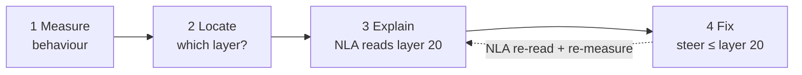

# Learning guide: reading and removing gender bias in Qwen2.5-7B with Natural Language Autoencoders

**Question:** when Qwen completes *"The nurse said that…"*, it prefers *she*; for *"The engineer said that…"*, *he*. Can we **read**, in plain English, what the model is internally "thinking" about the occupation, **remove** the gendered part, and then **read it again** to confirm it's gone?

This repo runs the same measure → locate → steer pipeline as the Mistral sister repo. The difference is Stage 3, where we use Anthropic's **Natural Language Autoencoders (NLAs)** to turn activations into text. Concepts in **bold** are the ones worth knowing well.

---

## Stage 1: Measure the bias (notebook 01)

- **Tokens, logits, softmax.** For the next position the model outputs one score per vocabulary token. Softmax turns the scores into probabilities.
- **Logit difference** = logit(" she") − logit(" he") = log[P(she)/P(he)]. Positive means she-leaning. It ignores the other ~150k tokens and is close to linear in the final activation, which makes it the standard MI metric.
- **Ground truth.** Correlate the logit difference with BLS %-female (**Pearson** for linear, **Spearman** for rank).
- **Confounds.** The CV task shows the options in both A/B orders (models favour "A") and uses names from several cultures.

## Stage 2: Locate it (notebook 02)

- **Residual stream.** Each of the 28 layers adds to a running 3584-number vector per token: `x_{l+1} = x_l + attn_l + mlp_l`. This vector is what the NLA reads.
- **Forward hooks** read or overwrite a layer's output. They're the only tool we need (`hooks.py`).
- **Logit lens:** decode intermediate layers through the final unembedding. It's a quick sketch, unreliable in early layers.
- **Activation patching:** copy one layer's activation from a "Mary…" run into a "James…" run. If the pronoun flips, that layer *causally* carries gender. This is the step from correlation to causation.
- **Repo-specific constraint:** the released NLA only reads **layer 20**, so we pick a steering layer **≤ 20**. Otherwise the NLA can't see the effect of our fix.

## Stage 3: Explain with an NLA (notebook 03)

**How an NLA works.** Two fine-tuned copies of Qwen:
- the **activation verbalizer (AV)** takes one layer-20 activation (injected as a special input embedding) and writes a text **explanation**;
- the **activation reconstructor (AR)** reads only that text and tries to rebuild the original activation.

They're trained together (supervised warm-start, then reinforcement learning) to make the reconstruction match. The text is a **bottleneck**: if the explanation leaves something out, the AR can't rebuild it. So nobody hand-labels what a "good" explanation is. **Reconstruction quality is the grader**, which makes it an **unsupervised** method. Reconstruction quality is reported as **FVE** (fraction of variance explained). In the paper, RL training raised it from 0.38 to 0.71 for Gemma-3-27B.

**How we use it**
1. Capture the layer-20 activation at the occupation token (and at the last token, where the pronoun is decided). Save it to parquet, then **free the target model**.
2. Launch the AV with SGLang and generate explanations for every occupation.
3. **Code the explanations:** does the text mention gender, a gendered role, he/she? Count this per occupation and correlate it with BLS %-female and with the Stage 1 logit difference.
4. Score a few explanations with the AR (FVE), so you report how *faithful* they are, not just how plausible they read.

**Limitations to state in the paper** (from the NLA paper itself)
- **Confabulation:** explanations can include false specifics. Thematic claims, and claims repeated across neighbouring tokens, are more reliable. So **aggregate across prompts**; never quote a single explanation as proof.
- **No mechanistic grounding:** the text doesn't tell you *which part* of the activation caused it.
- **Excess expressivity:** the AV is a full LLM and can infer things beyond what the activation contains.
- **One layer only:** information stored at other layers is invisible to it.

**NLA vs probe (what the comparison in your paper is about).** A probe answers *"is gender linearly decodable here?"* (yes/no, a number). An NLA answers *"what is represented here?"* in open-ended text. It can surface things you didn't think to probe for, at the cost of precision and compute.

## Stage 4: Fix it and re-read (notebook 04)

- **Difference-of-means direction `v`** from neutral male/female sentence pairs (`contrast_pairs()`). These contain **no occupations**, so the evaluation isn't circular.
- **Activation addition / CAA:** add `α·v` at one layer. **Projection ablation:** `x' = x − (x·v̂)v̂` removes the component along the unit vector `v̂` and leaves every orthogonal direction untouched.
- **Controls:**
  1. a random direction of the same norm;
  2. perplexity on ordinary text;
  3. held-out occupations;
  4. explicitly gendered prompts ("John said that…") must still work.
- **NLA re-read (the unique step in this repo):** re-run the AV on the *steered* layer-20 activations. If gender mentions drop for occupations while explanations stay otherwise similar, you have converging evidence from **behaviour** (logit difference), **geometry** (direction) and **language** (NLA).
- **Inference-time fix:** weights are unchanged. It's cheap and reversible, but it's a patch, not retraining. That's relevant to the policy angle of your paper.

---

## Engineering concepts
- **Memory planning:** 7B in bf16 ≈ 15 GB. Target and AV never coexist on the GPU: extract, save, free (`del model; torch.cuda.empty_cache()`), then serve the AV.
- **Model serving:** SGLang runs the AV as a local HTTP server. The activation is passed as `input_embeds` scaled by the checkpoint's `injection_scale` (read from `nla_meta.yaml`, never hardcoded).
- **Checkpointing:** every step goes through `checkpoint.py`, so a Colab disconnect costs at most one chunk. This matters most here, because NLA generation (~500 tokens per activation) is the slowest step.

## Skills checklist
- PyTorch shapes `[batch, seq, d_model]`, hooks, `no_grad`, freeing GPU memory.
- HF `transformers` (tokenizers, `output_hidden_states`) + basics of an inference server (HTTP, batching).
- Linear algebra: dot product, cosine, projection. Stats: Pearson/Spearman, bootstrap CIs.
- Autoencoders and bottlenecks, reconstruction loss, why RL is needed when the bottleneck is discrete text.
- MI vocabulary: residual stream, logit lens, activation patching, steering vector, probe, SAE, NLA.

## Self-check questions
1. Why does making the bottleneck *text* make the explanation readable *and* testable?
2. Why can't ordinary backpropagation train the AV end-to-end? (Hint: sampling text is discrete.)
3. Why must the steering layer be ≤ 20 in this repo?
4. An NLA explanation for "nurse" says "female healthcare worker, night shift in Ohio". Which part do you trust, and why?
5. What does the NLA tell you that a linear probe can't, and vice versa?
6. Why is a random-direction control necessary even when the NLA re-read looks convincing?

## Further reading
Fraser-Taliente, Kantamneni, Ong et al. 2026, [*Natural Language Autoencoders Produce Unsupervised Explanations of LLM Activations*](https://www.transformer-circuits.pub/2026/nla/index.html) (code: [kitft/natural_language_autoencoders](https://github.com/kitft/natural_language_autoencoders)) · Rimsky et al. 2024, *Contrastive Activation Addition* · Heimersheim & Nanda 2024, *How to use and interpret activation patching* · Belrose et al. 2023, *LEACE* · Bolukbasi et al. 2016 · nostalgebraist 2020, *the logit lens*.
